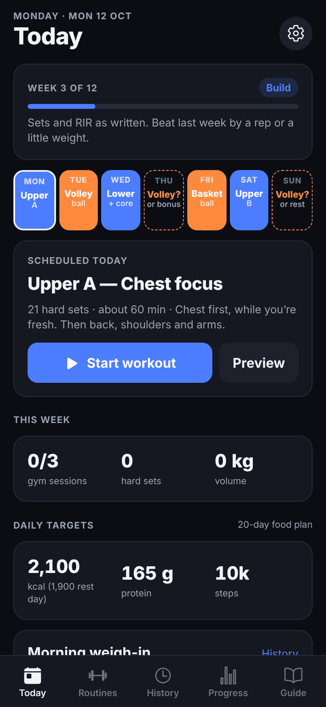
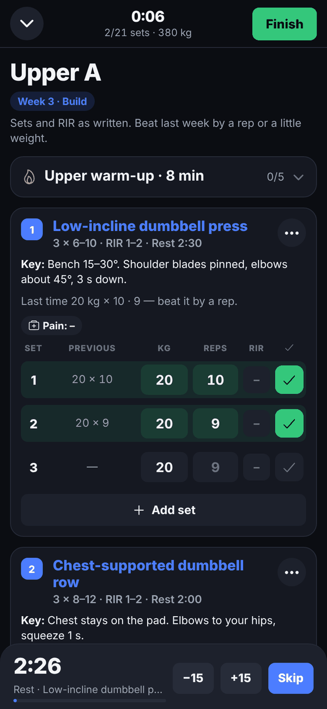
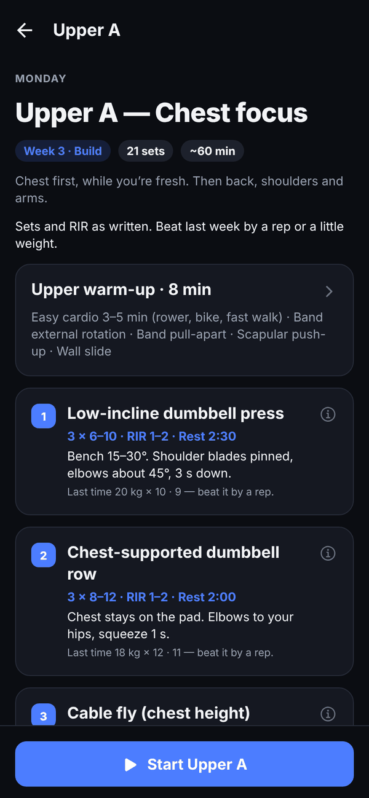
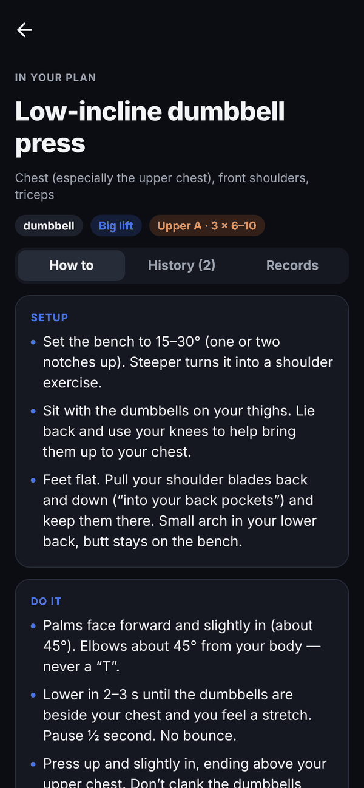
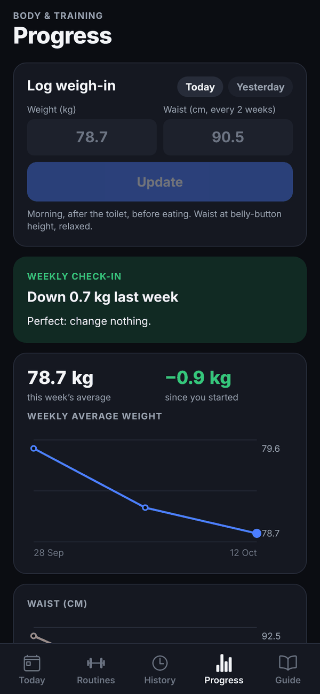
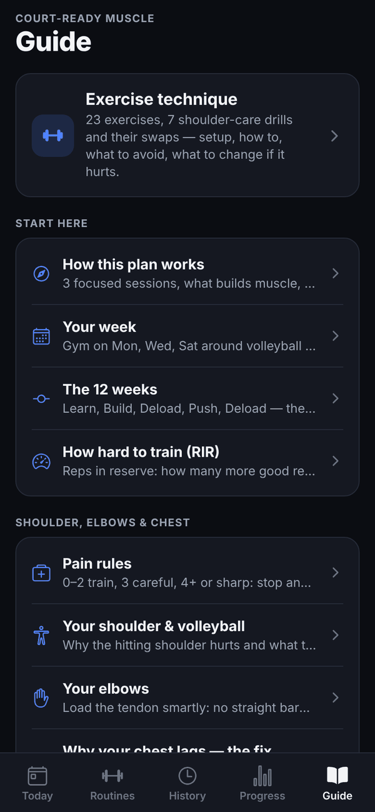

# Court-Ready

A workout tracker in the style of Hevy, built around the **Court-Ready Muscle** program: three gym sessions a week
around volleyball and basketball, with extra chest work and exercises that go easy on the shoulders and elbows. The
whole guide is inside the app: every routine, technique notes for each exercise, the 12-week plan, pain rules, warm-ups
and the food targets.

It runs on iPhone and Android. It's built with Expo (React Native + TypeScript) and keeps all your data on your phone.

<p>
  
  
  
  
  
  
</p>

## Get it on your phone

### iPhone: web app on your home screen (easiest)

1. Open **https://larrymijo.github.io/court-ready/** in Safari.
2. Tap **Share**, then **Add to Home Screen**.

It opens full screen like a normal app and works offline once it has loaded. Workouts are stored in the app on your
phone. Use **Settings → Export backup** now and then to save a copy to Files, in case you delete the app or clear
Safari's data.

> The web app is published by the CI workflow. GitHub Pages has to be switched on once: **Settings → Pages → Build and
> deployment → Source: GitHub Actions**.

### Android: install the APK

On your Android phone, download
**[court-ready.apk](https://github.com/larrymijo/court-ready/releases/download/android-latest/court-ready.apk)** and open
it. Allow installing from your browser when Android asks. If Play Protect warns about an unknown app, choose
**Install anyway**: the APK is built by this repo's GitHub Actions and signed with a development key, not a Play Store key.

Every push to `main` builds a new APK and replaces that download. Installing a newer one over the old one keeps your
data. The web app link above works on Android too.

### Run it from the code with Expo Go (for developing)

You need [Node.js](https://nodejs.org) 20.19+ or 22+ on your computer and the **Expo Go** app on your phone
([App Store](https://apps.apple.com/app/expo-go/id982107779), [Google Play](https://play.google.com/store/apps/details?id=host.exp.exponent)).

```bash
git clone https://github.com/larrymijo/court-ready.git
cd court-ready
npm install
npx expo start
```

Scan the QR code with the iPhone camera (on Android, scan it from inside Expo Go). Your phone and computer must be on the
same Wi-Fi. If the phone can't connect (university networks like eduroam often block this), use
`npx expo start --tunnel`. The app reloads as soon as you save a file.

Expo Go loads the app from your computer, so it only works while `npx expo start` is running. For everyday use, install
the web app or the APK.

## What's inside

**Train**

- **Today:** where you are in the 12-week plan, your week (gym days around volleyball and basketball), today's session,
  this week's numbers and your daily targets.
- **Routines:** Upper A (chest focus), Lower + Core, Upper B and an optional Bonus session, each with sets, reps, effort
  (RIR), rest time and a coaching cue per exercise. Supersets are grouped.
- **12-week plan built in:** Learn (weeks 1–2: one set less, easy effort), Build (3–6), Deload (7), Push (8–11: an extra
  set on the main lifts), Deload (12), then it repeats. Targets adjust by themselves each week.
- **Game mode** for the Lower session when you have a match the next day: fewer sets, easier effort, no split squats.

**Log** (like Hevy)

- A set table with last time's numbers next to each set. Tap the check mark to log; an empty field takes what's shown in
  grey, so a repeated set is one tap.
- A rest timer starts when you tick a set, with −15 s / +15 s / Skip, and buzzes when it's over.
- Suggestions from double progression: "beat it by a rep", or "add weight" once you hit the top of the range on every set.
  Deload weeks keep your weights.
- Ramp-up warm-up sets worked out from your working weight, plus the 8-minute warm-up checklist.
- A pain rating (0–10) for each exercise. At 4 or more it tells you to stop and offers shoulder- or elbow-friendly swaps.
- Swap or add exercises, add notes, keep the screen on. A workout in progress survives closing the app.

**Learn and track**

- 49 exercises with setup, how to do it, what to avoid and what to change if it hurts: 23 from the program, 7
  shoulder-care drills and 19 swaps. Each one has its history, a progress chart and records (best weight, estimated
  1-rep max, best volume).
- History of every workout, with volume, duration and new personal records.
- Progress: morning weigh-ins, weekly average weight and waist charts, a weekly check-in that tells you whether to change
  your food, hard sets per muscle against the plan, and workouts per week.
- The full guide in 18 short articles: how the plan works, your week, the 12 weeks, RIR, pain rules, shoulder and
  volleyball, elbows, why your chest lags, lifts to skip, warm-ups, technique, how to progress, recovery, food (2,100
  kcal, 165 g protein, 10,000 steps), tracking, when life gets in the way, swaps, and a cheat sheet.
- Settings: when your program started (move it a week back or forward), the rest timer, vibration, keeping the screen
  on, and backup export and import.

## Your data

Nothing leaves your phone: there's no account and no server. Everything is saved on the device (AsyncStorage on
iPhone and Android, browser storage in the web app). **Export backup** gives you a JSON file you can keep anywhere, and
**Import** restores it, also from one version of the app to another (for example from Expo Go to the APK).

## Change the program

Everything the app shows comes from plain TypeScript files in `src/data/`:

| File | What's in it |
| --- | --- |
| `src/data/routines.ts` | The four sessions: exercises, sets, rep ranges, RIR, rest, cues, supersets |
| `src/data/exercises.ts` | Every exercise: muscles, equipment, weight step, technique text, swaps |
| `src/data/schedule.ts` | Which day is gym, sport or optional, and the daily food/step targets |
| `src/data/guide.ts` | The guide articles and warm-ups. `**bold**` and `[[slug-or-exercise-id\|link text]]` work in text |

The rules for the 12 weeks (sets per phase, deloads, game mode) are in `src/lib/program.ts`. Progression suggestions are
in `src/lib/progression.ts`.

## Development

```bash
npm start            # Expo dev server (press w for the web version)
npm run lint         # ESLint (expo lint)
npm run typecheck    # TypeScript
npm test             # Jest: program weeks, progression, stats, weekly check-in
```

```
src/
  app/          Screens (Expo Router: every file is a route)
    (tabs)/     Today, Routines, History, Progress, Guide
    workout.tsx The live workout
  components/   UI pieces; workout/ holds the set table, rest timer, pain picker
  data/         The program and guide content
  lib/          Program weeks, progression, stats, dates, formatting (with tests)
  store/        App state (Zustand, saved to the device)
scripts/        Turns the web export into an installable, offline web app
```

The app only uses modules that ship with Expo Go (AsyncStorage, SVG, haptics, keep-awake, icons), so it runs in Expo Go
without a custom build. `android/` and `ios/` aren't in the repo: Expo generates them from `app.json` when needed.

### CI

`.github/workflows/ci.yml` runs on every push and pull request:

1. **Lint, typecheck, test.**
2. **Web app:** `expo export --platform web`, then `scripts/finish-web-build.mjs` adds the home-screen tags, an offline
   service worker and a 404 fallback for deep links. Pushes to `main` deploy it to GitHub Pages.
3. **Android APK:** `expo prebuild` and `./gradlew assembleRelease`. The APK is uploaded as a workflow artifact, and pushes
   to `main` also publish it as the `android-latest` release (the download link above).

### Other ways to build Android

- **EAS (Expo's cloud build):** `npx eas-cli@latest build -p android --profile preview` gives an installable APK
  (`eas.json` is set up; you need a free Expo account).
- **On your computer** (Android Studio and JDK 17):
  `npx expo prebuild -p android && cd android && ./gradlew assembleRelease`.
  The APK ends up in `android/app/build/outputs/apk/release/`.

A native iPhone build (instead of the web app or Expo Go) needs an Apple Developer account:
`npx eas-cli@latest build -p ios`.

---

General training guidance, not medical advice. Sharp pain, pain that keeps getting worse, numbness or pain at night
means see a doctor or physiotherapist.
